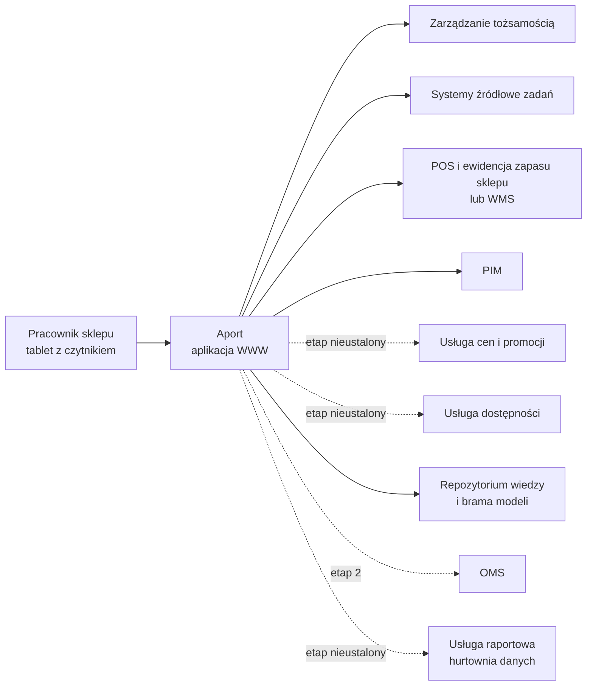

# Koncepcja architektury: Aport dla Pupilii

**Zatwierdzenie:** Andrzej Sobczak, ekspert ds. procesów i cyfryzacji,
2026-11-22 — koncepcja w treści z tego dnia, z zachowaniem oznaczeń Plan,
Kierunek i Interpretacja. Pytania pozostają otwarte.

## Cel i granice rozwiązania

**Rozwiązanie:** Aport, czyli środowisko pracy pracowników sklepów Pupilii
(zakres w [PRD](prd-aport.md), wymagania etapu 1 w
[specyfikacji](wymagania-aport-etap-1.md)). Systemy sieci, ich odpowiedzialności
i integracje między nimi opisuje
[[wiki/architecture/pupilia-systemy|mapa systemów Pupilii]]. Ten dokument
pokazuje tylko miejsce Aportu w tej mapie.

Oznaczenia: **Plan** — opis działalności; **Kierunek** — wywiad z dyrektorką;
**Interpretacja** — wniosek analityka do potwierdzenia. Źródła: OPIS —
`raw/inbox/Pupilia_opis_dzialalnosci_wyczyszczona_1_0.md` (numer wiersza);
DYR — `raw/inbox/pupilia_wywiad_dyrektorka.md`; AS-IS —
`raw/inbox/pupilia_wywiad_4_sprzedaz_w_sklepie_AS-IS.md` (znacznik czasu).

**Dziś** Aportu nie ma. Pracownik sklepu korzysta z ekranu kasy, który pokazuje
skróconą nazwę, cenę i stan tylko własnego sklepu. Kierownik ma komputer
na zapleczu z dostępem do stanów sieci i poczty. Pozostałe ustalenia są
na kartkach i w zeszycie [AS-IS 00:11:30, 00:27:49, 00:27:55, 00:40:46].

**Docelowo (Plan):**

- Aport jest responsywną aplikacją WWW do pracy sklepów i współpracy z centralą.
  W ograniczonym zakresie korzystają z niego magazyn i COK; konsultanci COK
  pracują w CRM [OPIS w. 200].
- Aport udostępnia funkcje systemów nadrzędnych. Nie jest kasą, księgą ani
  rejestrem zapasu [OPIS w. 202].
- Urządzenia w sklepie: tablety z czytnikami kodów dwuwymiarowych i drukarki
  etykiet. Prywatne telefony nie służą do czynności ewidencyjnych [OPIS w. 208].
  Tablet jest służbowy, przenoszony na salę i zaplecze; liczbę tabletów
  na sklep sprawdzi pilotaż [DYR 00:42:33].
- Kolejność według kierunku dyrektorki: etap 1 to zadania, dostawy, rozbieżności
  i asystent; etap 2 to odbiory [DYR 00:55:07].

## Zasady architektoniczne i standardy

Zasady wspólne dla całej sieci są w
[[wiki/architecture/pupilia-systemy|mapie systemów]]. Poniżej tylko to, co dotyczy
Aportu.

| Zasada | Zakres i wyjątki | Stan | Źródło |
|---|---|---|---|
| Aport nie prowadzi własnej ewidencji; wynik czynności zapisuje system nadrzędny, z którego pochodzi zadanie lub dane | Wszystkie funkcje | Plan | OPIS w. 202, 206 |
| Dostęp nadaje usługa zarządzania tożsamością, według sklepu, roli i zadania; każdy pracownik ma własne konto, także na wspólnym tablecie | Wszyscy użytkownicy | Plan; Kierunek | OPIS w. 208, 307; DYR 00:42:33 |
| Zadania bieżące pochodzą z systemów operacyjnych i są aktualizowane niezależnie od nocnego zasilania hurtowni; analizy trendów pochodzą z hurtowni przez kontrolowaną usługę raportową | Zadania, pulpit kierownika | Plan | OPIS w. 218, 321 |
| Asystent w Aporcie korzysta ze wspólnej z AsAI bramy modeli, ale ma własną tożsamość techniczną, narzędzia, zakres źródeł, uprawnienia i testy akceptacyjne | Asystent pracowników | Plan | OPIS w. 263 |
| Usługa danych sprawdza dostęp pracownika przed przekazaniem treści do modelu | Procedury wewnętrzne, warunki zakupu, dane kosztowe | Plan | OPIS w. 224, 265 |
| Asystent korzysta tylko z zatwierdzonych treści (karty PIM, instrukcje) ze źródłem i wersją; miary liczy warstwa analityczna, nie model | Asystent pracowników | Plan | OPIS w. 97, 224, 226 |
| Dostępność w Aporcie podlega tym samym regułom co w pozostałych kanałach (P-05–P-07) | Dostępność, wydzielona pula | Plan | OPIS w. 127 |

## Systemy i odpowiedzialności

Które systemy obsługują funkcje Aportu. Aport jest w każdym wierszu interfejsem;
dane prowadzi system w drugiej kolumnie.

| Funkcja Aportu | System nadrzędny | Etap | Stan i źródło |
|---|---|---|---|
| Logowanie, role, przypisanie do sklepu | Usługa zarządzania tożsamością | 1 | Plan: OPIS w. 208, 307 |
| Zadania na zmianie i zapis ich wykonania | System, z którego pochodzi zadanie | 1 | Plan: OPIS w. 206. Które systemy są źródłem zadań etapu 1 — pytanie 1 |
| Przyjęcie dostawy, porównanie z dokumentem wysyłki | WMS lub ewidencja zapasu sklepu; dokument wysyłki z magazynu centralnego | 1 | Plan: OPIS w. 202, 212. Wybór systemu — pytanie 2 |
| Zgłoszenie różnic w dostawie do logistyki | Nie wskazano | 1 | Plan: OPIS w. 212, 220. Pytanie 3 |
| Zgłoszenie rozbieżności stanu, korekta, inwentaryzacja, przesunięcie, odpis | Interpretacja: ewidencja zapasu sklepu przy POS albo WMS | 1 | Plan: OPIS w. 214; system — OPIS w. 202, 300 (pytanie 2, PI-11) |
| Karta produktu i porównanie wariantów | PIM (cechy, opisy, instrukcje) | 1 | Plan: OPIS w. 95–97; wymagania W-20–W-23 |
| Cena, promocja i dostępność przy produkcie | Usługa cen i promocji; usługa dostępności | nieustalony (PI-30, PI-03) | Plan: OPIS w. 103, 127; Kierunek: DYR 00:42:33. Wymagania etapu 1 ich nie obejmują |
| Asystent: wiedza produktowa i procedury | Repozytorium wiedzy i brama modeli; PIM | 1 | Plan: OPIS w. 224, 306 |
| Przesunięcie do wydzielonej puli | Usługa dostępności i ewidencja zapasu (P-02) | 2 | Plan: OPIS w. 115, 123 |
| Kompletacja zamówienia, gotowość, wydanie | OMS; usługa powiadomień | 2 | Plan: OPIS w. 176, 296, 303 |
| Przyjęcie i wydanie paczek z magazynu | Interpretacja: OMS (gotowość, wydanie); system zapisujący skany nie jest wskazany | 2 | Plan: OPIS w. 184 |
| Pulpit kierownika | Hurtownia danych przez usługę raportową; systemy operacyjne | nieustalony | Plan: OPIS w. 218 |
| Propozycje uzupełnień i domówienia | ERP (planowanie uzupełnień) | nieustalony | Plan: OPIS w. 212, 293 |
| Propozycja koszyka | Platforma e-commerce, OMS | nieustalony | Plan: OPIS w. 153 |
| Przyjęcie zwrotu zakupu internetowego | OMS, ewidencja zapasu (miejsce oceny) | nieustalony | Plan: OPIS w. 196. System rejestru zwrotów nie wskazany |
| Komunikaty, instrukcje, szkolenia; zgłoszenia do centrali | Nie wskazano | nieustalony | Plan: OPIS w. 220. Pytanie 3 |

**Zależność etapu 1 od nowych systemów (Interpretacja).** Etap 1 Aportu wymaga
systemów, które program dopiero buduje [OPIS w. 309]:

- usługi zarządzania tożsamością (konta i role);
- PIM z zatwierdzonymi kartami produktów (asystent i porównanie);
- repozytorium wiedzy i bramy modeli (asystent);
- platformy integracyjnej;
- usługi dostępności i usługi cen — tylko jeśli cena i dostępność wejdą do etapu 1
  (PI-30).

Dyrektorka chce uruchomić asystenta „na zatwierdzonych kartach produktów”
[DYR 00:55:07]. Harmonogramu tych systemów źródła nie podają (pytanie 5).

Linie ciągłe to etap 1, przerywane to etap 2 albo etap nieustalony. Połączenia mogą
prowadzić przez platformę integracyjną [OPIS w. 287]; diagram jej nie pokazuje.

## Integracje

| Skąd → dokąd | Przekazywane dane | Sposób wymiany | Sytuacje błędne i ograniczenia | Źródło |
|---|---|---|---|---|
| Systemy źródłowe → Aport | Zadania z terminem i skutkiem opóźnienia | Nie podano; w trakcie zmiany, niezależnie od hurtowni | Opóźniona dostawa lub wycofanie partii muszą dotrzeć w trakcie pracy, nie następnego dnia | OPIS w. 206, 321; DYR 00:48:30, 01:00:27 |
| Aport → system źródłowy zadania | Wykonawca, czas, wynik | Nie podano | — | OPIS w. 206 |
| Aport → ewidencja zapasu / WMS | Przyjęcie, rozbieżność, korekta z powodem, inwentaryzacja, przesunięcie, odpis | Nie podano | Korekta bez uprawnienia lub powodu odrzucona (P-27). Przerwane przyjęcie musi dać się dokończyć przez inną osobę (W-13) | OPIS w. 214; DYR 00:44:49 |
| Usługa dostępności → Aport | Dostępność | Odczyt; replika do 60 s | Nieuzgodniony stan wstrzymuje zobowiązania (P-06, P-07) | OPIS w. 127, 129 |
| PIM, usługa cen → Aport | Karty produktów z wersją, ceny i promocje | Nie podano | Brak zatwierdzonej karty: pracownik widzi brak, nie zastępczą odpowiedź (W-22) | OPIS w. 97, 103 |
| Aport (asystent) → brama modeli; repozytorium wiedzy → asystent | Pytanie, zatwierdzone treści, odpowiedź ze źródłem | Przez usługę danych sprawdzającą dostęp | Treści wejściowe kontrolowane pod kątem wstrzyknięcia instrukcji i ujawnienia informacji. Gdy asystent nie odpowiada, karty i instrukcje nadal dostępne (W-28) | OPIS w. 263, 265; DYR 00:52:59 |
| Aport → hurtownia danych | Zdarzenia Aportu z czasem zdarzenia i pozyskania | Zasilanie dzienne | — | OPIS w. 319, 321 |
| OMS ↔ Aport (etap 2) | Zadanie kompletacji, gotowość, wydanie | Nie podano | Po utracie połączenia tuż po wydaniu paczki trzeba ustalić, czy wydanie doszło do skutku, zanim ktoś wyda ponownie lub uruchomi zwrot | OPIS w. 176; DYR 00:36:02 |

## Decyzje i pytania

Pytania zebrano też w [liście pytań do interesariuszy](pytania-do-interesariuszy.md);
odpowiedzi są zapisywane tam.

Decyzji architektonicznych dotyczących Aportu źródła nie zawierają. Nie zapisano
tu wariantów rozwiązania; wymagają one odpowiedzi na pytania poniżej.

1. **Źródło zadań etapu 1.** Z których systemów pochodzą zadania (dostawy,
   wycofania partii, komunikaty) i gdzie zapisuje się ich wykonanie
   (specyfikacja, pytanie 7)?
2. **Ewidencja zapasu sklepu.** Czy przyjęcie dostawy i korekta zapisują się
   w WMS, w ewidencji sklepu przy POS, czy w ERP [OPIS w. 111, 202, 300]? Pytanie
   łączy się z audytem POS (mapa systemów, pytania 1–2).
3. **Zgłoszenia sklepów do centrali** (logistyka, jakość, IT) i komunikaty: który
   system jest dla nich nadrzędny? CRM obsługuje sprawy klientów [OPIS w. 302],
   nie sklepów.
4. **Praca bez łączności.** OPIS przewiduje ją dla POS [w. 300], dla Aportu nie.
   Kasa traci sieć w szczycie [AS-IS 00:59:30]; dyrektorka chce sprawdzić utratę
   połączenia przy wydaniu [DYR 00:36:02]. Co Aport ma robić bez łączności?
   (PRD, pytanie 3)
5. **Harmonogram systemów, od których zależy etap 1:** zarządzanie tożsamością,
   PIM, repozytorium wiedzy, platforma integracyjna.
6. **Model zapasowy i tryb ograniczony.** OPIS opisuje je w części o AsAI
   [w. 281, 283]. Czy dotyczą także asystenta w Aporcie?
7. **Dostęp magazynu i COK do Aportu** — „w ograniczonym zakresie” [OPIS w. 200].
   Jakie funkcje?

Wymagania jakościowe: [katalog NFR Aportu](nfr-aport.md).

## Źródła i powiązania

- OPIS: przeczytany w całości (w. 1–347); wykorzystane sekcje 5, 7, 8 (w. 263–283)
  i 9.
- DYR i AS-IS: fragmenty o urządzeniach, łączności i systemach (znaczniki w tekście).
- Kontekst: [[wiki/architecture/pupilia-systemy|mapa systemów Pupilii]],
  [[wiki/domain/pupilia-reguly-sprzedazy|reguły biznesowe]],
  [[wiki/domain/pupilia-model-dziedziny|model dziedziny]].
- Projekt: [PRD](prd-aport.md), [wymagania etapu 1](wymagania-aport-etap-1.md),
  [katalog NFR](nfr-aport.md).
