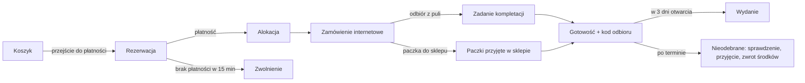

# Model dziedziny: sprzedaż i realizacja zamówień Pupilii

## Kontekst i granice

Dotyczy sieci sklepów zoologicznych Pupilia: sprzedaży w sklepie, zapasu
i dostępności, zamówień internetowych z udziałem sklepów, klienta oraz spraw
posprzedażowych. Granice są takie same jak w
[[wiki/domain/pupilia-reguly-sprzedazy|regułach biznesowych]]. Model opisuje
pojęcia biznesowe i ich powiązania, a nie tabele ani klasy systemów.

Znaczenie pojęć podaje [[wiki/domain/pupilia-slownik|słownik pojęć]] (zatwierdzony);
tu nie powtarzam definicji. Większość modelu opisuje **plan** z opisu działalności.
Pojęcia stanu obecnego oznaczono „Dziś”, a pojęcia oparte tylko na wypowiedzi
dyrektorki bez podjętej decyzji — „Kierunek”. Krotności podaję tylko wtedy, gdy wynikają
wprost ze źródła; w pozostałych przypadkach wpisuję „nie ustalono” i zadaję pytanie.

Oznaczenia źródeł jak w regułach: **OPIS** — `raw/inbox/Pupilia_opis_dzialalnosci_wyczyszczona_1_0.md`
(numer wiersza), **DYR** — `raw/inbox/pupilia_wywiad_dyrektorka.md`, **AS-IS** —
`raw/inbox/pupilia_wywiad_4_sprzedaz_w_sklepie_AS-IS.md` (znacznik czasu).

**Zatwierdzenie:** Andrzej Sobczak, ekspert ds. procesów i cyfryzacji,
2026-11-22 — model w treści z tego dnia. Krotności oznaczone „nie ustalono”
i pytania z ostatniej sekcji pozostają otwarte.

## Pojęcia

| Pojęcie | Znaczenie lub odnośnik do słownika | Istotne cechy i stany | Źródło |
|---|---|---|---|
| Wariant handlowy (SKU) | Słownik: „Wariant handlowy (SKU)” | Identyfikowany kodem EAN; wspólny identyfikator w ERP i PIM | OPIS w. 91, 95, 99 |
| Karta produktu | Słownik: „Karta produktu” | Właściciel, źródło, wersja, status zatwierdzenia; publikacja w kanale po uzupełnieniu wymaganych atrybutów | OPIS w. 95–97 |
| Sklep | Placówka sieci | Format: standardowy lub duży; własna ewidencja zapasu; limity zdolności realizacji | OPIS w. 13–18, 186 |
| Ewidencja zapasu sklepu | Słownik: „Ewidencja zapasu sklepu” | Aktualizowana sprzedażą w POS | OPIS w. 119, 300 |
| Wydzielona pula | Słownik: „Wydzielona pula” | Towar fizycznie oddzielony; przesunięcie potwierdzone w Aporcie | OPIS w. 115 |
| Rezerwacja | Słownik: „Rezerwacja” | Stany: aktywna (do 15 min) → zamieniona w alokację albo zwolniona | OPIS w. 133–135 |
| Alokacja | Słownik: „Alokacja” | Powstaje z rezerwacji po potwierdzeniu płatności | OPIS w. 135 |
| Blokada | Słownik: „Blokada” | Pomniejsza dostępność | OPIS w. 125 |
| Koszyk | Lista SKU i ilości przed złożeniem zamówienia | Dodanie do koszyka nie rezerwuje towaru | OPIS w. 91, 253 |
| Propozycja koszyka | Słownik: „Propozycja koszyka” | Identyfikator sklepu i pracownika; zatwierdza klient | OPIS w. 153 |
| Zamówienie internetowe | Słownik: „Zamówienie internetowe” | Utrwalone warunki: cena brutto, koszt dostawy, wiążący termin. Stany wymienione w źródłach: opłacone, w oczekiwaniu na decyzję klienta, gotowe do odbioru, wydane, nieodebrane, anulowane — lista niepełna | OPIS w. 168, 176–180 |
| Sposób otrzymania towaru | Jeden z czterech: zakup stacjonarny, odbiór z zapasu sklepu, dostawa kurierska, dostawa paczki do sklepu | Każdy ma własne źródło towaru i własne potwierdzenie realizacji | OPIS w. 157–162 |
| Paczka | Część przesyłki zamówienia | Masa, wymiary; przyjęcie w sklepie i wydanie potwierdzane skanem | OPIS w. 170, 184–186 |
| Kod odbioru | Słownik: „Kod odbioru” | Jednorazowy; nie trafia do sprawy w CRM | OPIS w. 176, 257 |
| Zadanie (Aport) | Czynność do wykonania przez pracownika | Rola, lokalizacja, termin, skutek opóźnienia; po zakończeniu: wykonawca, czas, wynik | OPIS w. 206 |
| Dostawa do sklepu | Towar wysłany do sklepu z dokumentem wysyłki | Przyjęcie przez skanowanie; uszkodzenia, niedobory i nadwyżki kierowane do rozstrzygnięcia | OPIS w. 212; DYR 00:44:07 |
| Zgłoszenie rozbieżności (Kierunek) | Słownik: „Zgłoszenie rozbieżności” | Nie zmienia stanu; widoczne dla kolejnej zmiany | DYR 00:45:31 |
| Korekta stanu | Słownik: „Korekta stanu” | Uprawnienie i powód; odrębna od inwentaryzacji, przesunięcia i odpisu | OPIS w. 214 |
| Klient | Osoba lub firma kupująca w sklepie albo w internecie | Może kupować bez konta i bez identyfikatora | OPIS w. 141 |
| Konto klienta | Słownik: „Konto klienta” | Rozpoznane zakupy z obu kanałów, listy zakupowe, stałe zestawy, zgody, zgłoszenia | OPIS w. 141 |
| Identyfikator klienta | Słownik: „Identyfikator klienta” | Przypisuje zakup; nie daje dostępu do historii | OPIS w. 141–143 |
| Profil zwierzęcia | Słownik: „Profil zwierzęcia” | Imię, gatunek, etap życia, masa, preferencje; użycie przez AsAI za zgodą | OPIS w. 145 |
| Stały zestaw | Słownik: „Stały zestaw” | SKU i ilości | OPIS w. 151 |
| Sprzedaż w kasie | Transakcja w POS zakończona paragonem albo fakturą | Dokument sprzedaży; z identyfikatorem klienta albo bez | OPIS w. 141, 159 |
| Odłożenie (Dziś) | Słownik: „Odłożenie” | Poza systemem: karteczka na towarze, stan w kasie bez zmian | AS-IS 00:20:41, 00:22:08 |
| Zwrot towaru | Słownik: „Zwrot towaru” | Przyczyna, ilość, ustalona partia, stan produktu, decyzja; miejsce oceny | OPIS w. 196 |
| Reklamacja, anulowanie, odstąpienie, zwrot środków | Słownik: „Anulowanie, odstąpienie, reklamacja, zwrot środków” | Odrębne procesy ze statusami; zwrot środków ma osobne stany „zlecony” i „potwierdzony przez operatora” | OPIS w. 194, 315 |
| Sprawa (CRM) | Słownik: „Sprawa” | Kontakty ze wszystkich kanałów i ustalenia | OPIS w. 192 |

## Relacje

| Pojęcie źródłowe | Znaczenie relacji | Pojęcie powiązane | Krotności i warunki, jeśli ustalone | Źródło |
|---|---|---|---|---|
| Receptura karmy | występuje w | Wariant handlowy (SKU) | Jedna receptura w różnych opakowaniach to różne SKU (np. 3 kg i 12 kg); fabryczny wielopak ma własny identyfikator | OPIS w. 91 |
| Kod EAN | identyfikuje | Wariant handlowy (SKU) | Liczba EAN na jeden SKU — nie ustalono | OPIS w. 99 |
| Wariant handlowy (SKU) | ma treść w | Karta produktu (PIM) | Powiązanie przez wspólny identyfikator SKU; krotność nie ustalona | OPIS w. 95 |
| Koszyk, stały zestaw, zestaw klienta | zawiera | Wariant handlowy (SKU) z ilością | Zestaw klienta nie tworzy nowego SKU | OPIS w. 91, 151 |
| Rezerwacja | obejmuje | Koszyk | Cały koszyk i zdolność realizacji; gdy jedna pozycja lub termin są niedostępne, rezerwacja nie powstaje | OPIS w. 133 |
| Rezerwacja | zamienia się w | Alokacja | Po potwierdzeniu płatności, bez ponownego pomniejszania dostępności | OPIS w. 135 |
| Alokacja | przypisuje zapas do | Zamówienie internetowe (opłacone) | Opłacone zamówienie bez alokacji to błąd wykrywany kontrolą | OPIS w. 135, 313 |
| Sklep | ma | Wydzielona pula | Liczba pul na sklep — nie ustalono | OPIS w. 115 |
| Sprzedaż w kasie | zmniejsza | Ewidencja zapasu sklepu | Nie pomniejsza wydzielonej puli | OPIS w. 119 |
| Zamówienie internetowe | jest realizowane przez | Sposób otrzymania towaru | Czy jedno zamówienie może mieć kilka sposobów — nie ustalono | OPIS w. 157–162 |
| Zamówienie internetowe | jest wysyłane w | Paczka | Jedna lub więcej paczek; powyżej 30 kg zamówienie jest dzielone | OPIS w. 184–186 |
| Zamówienie z dostawą do sklepu | staje się gotowe po przyjęciu | Paczka | Wszystkich paczek zamówienia | OPIS w. 184 |
| Zamówienie z odbiorem z puli | wywołuje | Zadanie (kompletacji) | Zadanie z terminem po płatności | OPIS w. 176 |
| Zamówienie internetowe | ma | Kod odbioru | Jednorazowy, wysyłany z powiadomieniem o gotowości | OPIS w. 176 |
| Propozycja koszyka | wskazuje | Sklep i pracownik | Identyfikator sklepu i pracownika | OPIS w. 153 |
| Propozycja koszyka | może prowadzić do | Zamówienie internetowe | Zasady przypisania przy zmianie koszyka, kilku propozycjach lub zwrocie — nie ustalono | OPIS w. 153; DYR 00:26:30 |
| Stały zestaw | przy ponowieniu tworzy | Zamówienie internetowe | Nowe zamówienie, zatwierdzane przez klienta | OPIS w. 151 |
| Klient | może mieć | Konto klienta | Zakup możliwy bez konta | OPIS w. 141 |
| Konto klienta | zawiera | Profil zwierzęcia | Wiele profili (np. dwa psy) | OPIS w. 145; DYR 00:24:19 |
| Sprzedaż w kasie | jest przypisana do | Konto klienta | Tylko po podaniu identyfikatora; bez niego poza historią | OPIS w. 141 |
| Zadanie (Aport) | pochodzi z i zapisuje wynik w | System źródłowy (OMS, WMS, POS, ERP) | Wynik w systemie, z którego zadanie pochodzi | OPIS w. 202, 206 |
| Dostawa do sklepu | może prowadzić do | Zgłoszenie sklepu do centrali (do logistyki) | Brak, uszkodzenie, nadwyżka | OPIS w. 212; DYR 00:44:07 |
| Zgłoszenie rozbieżności | może prowadzić do | Korekta stanu | Korektę wykonuje osoba uprawniona | OPIS w. 214; DYR 00:45:31 |
| Zwrot towaru (zakupu internetowego) | dotyczy | Zamówienie internetowe | Rejestr przyjęcia w Aporcie | OPIS w. 196 |
| Sprawa (CRM) | gromadzi | Kontakt klienta | Ze wszystkich kanałów; przekazanie z AsAI tworzy sprawę | OPIS w. 192 |
| Odłożenie (Dziś) | dotyczy | Sztuka towaru w sklepie | Poza systemem; nie zmienia stanu w kasie | AS-IS 00:22:08 |

Główny ciąg zamówienia z odbiorem w sklepie (plan, bez krotności):

## Reguły i ograniczenia

Obowiązujące reguły są w [[wiki/domain/pupilia-reguly-sprzedazy|regułach biznesowych]]
(zatwierdzone 2026-11-22). Dla modelu najważniejsze: dostępność i rezerwacje
(P-05–P-10), pula (P-02–P-04), terminy i gotowość (P-15, P-17–P-21), limity sklepu
(P-23), konto i dostęp (P-11–P-12), zwroty (P-25–P-26), korekty (P-27).

## Pytania

Pytania zebrano w
[[projects/pupilia/Outputs/pytania-do-interesariuszy|liście pytań do interesariuszy]]
projektu Aport; odpowiedzi są zapisywane tam.

1. Ile kodów EAN może mieć jeden SKU (np. zmiana opakowania)? Dyrektorka chce,
   żeby klient przy zmianie opakowania dowiedział się, że chodzi o ten sam wariant
   [DYR 00:27:59].
2. Czy sklep ma jedną wydzieloną pulę, czy kilka? Gdzie jest ewidencjonowana:
   w WMS czy w ewidencji sklepu [OPIS w. 202]?
3. Czy jedno zamówienie może łączyć kilka sposobów otrzymania towaru, np. część
   z puli sklepu i część z magazynu?
4. Pełna lista statusów zamówienia w OMS nie jest podana; model wymienia tylko
   stany wspomniane w źródłach.
5. Czym różni się lista zakupowa od stałego zestawu na koncie [OPIS w. 141, 151]?
6. Jak powiązać zamówienie z propozycją koszyka przy zmianach koszyka, kilku
   propozycjach i zwrotach [DYR 00:26:30]?
7. Czy odłożenie telefoniczne stanie się pojęciem modelu docelowego (zob. pytanie 2
   w regułach)?
8. Jak partia towaru wiąże się ze sprzedażą i zwrotami w sklepie, gdy partię
   oszacowano z ruchów EAN [OPIS w. 214]?
